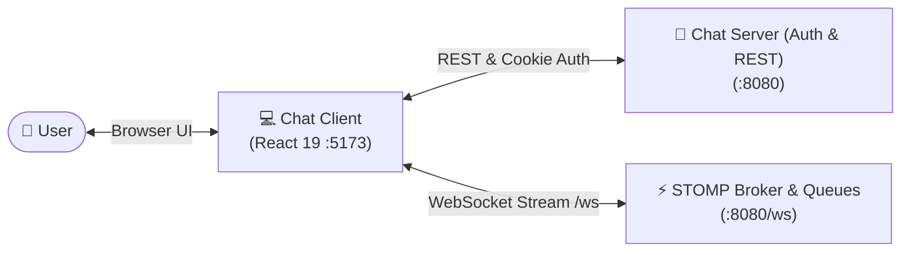

# 💬 Chat Server Front

> A sleek, minimal, and real-time messaging web client built with **React 19**, **Vite 8**, and **Tailwind CSS v4**. Designed for instant bidirectional chat streaming over WebSockets, powered by a Spring Boot backend.

<p align="left">
  
  
  
  
  
</p>

---

## 🏛 Architecture Overview



> **Backend Companion:** Powered by [hesamjafari06/chat-server](https://github.com/hesamjafari06/chat-server).

---

## ✨ Key Features

- **Real-Time Messaging:** Bidirectional message streaming over persistent WebSocket connections (`/ws`) with live channel updates.
- **Channels & Groups:** Create custom public/private channels and group chats with unique identifiers and member routing.
- **Interactive Audio Feedback:** Integrated auditory alerts (`confirm.mp3`, `error.mp3`) alongside toast notifications (`react-hot-toast`).
- **Profile & Account Management:** In-app dashboard for managing user profiles, updating credentials, and editing public handles.
- **Protected Routing:** Strict authentication guards (`ProtectedRoutes` and `PrivateRoutes`) with cookie-based session verification.
- **Dark Aesthetic:** Minimalist dark-mode user experience with responsive layout transitions.

---

## 🚀 Quickstart

### 1. Clone the Repository
```bash
git clone https://github.com/mhmdnyb/chat-server-front.git
cd chat-server-front/chat-project
```

### 2. Install Dependencies
```bash
npm install
```

### 3. Start the Development Server
```bash
npm run dev
```

Open [http://localhost:5173](http://localhost:5173) in your browser.

---

## ⚙️ Backend Connectivity

The frontend connects directly to the [chat-server](https://github.com/hesamjafari06/chat-server) running at `http://localhost:8080`:

| Protocol | Endpoint | Purpose |
|---|---|---|
| **HTTP (REST)** | `http://localhost:8080` | User registration, login, and profile operations |
| **WebSocket** | `ws://localhost:8080/ws?token=...` | Live message dispatch and queue subscriptions |

---

## 🛠 Tech Stack

| Layer | Technologies |
|---|---|
| **Core Framework** | React 19, Vite 8 |
| **Styling** | Tailwind CSS v4, Custom CSS Modules |
| **Routing & Navigation** | React Router 8 |
| **Real-Time Communication** | Native WebSockets / STOMP Queues |
| **UI Feedback** | React Hot Toast, Custom Audio Assets |

---

## 📁 Repository Structure

```text
chat-server-front/
├── chat-project/
│   ├── src/
│   │   ├── assets/              # Audio effects (confirm/error), icons, favicons
│   │   ├── components/          # Reusable components
│   │   │   ├── ChatMessage/     # Message bubble component
│   │   │   ├── ChatSection/     # Real-time WebSocket message feed
│   │   │   ├── Create/          # Channel & group creation modals
│   │   │   ├── Dashboard/       # User dashboard component
│   │   │   └── UserProfile/     # Profile & settings modal
│   │   ├── pages/               # Top-level view routes
│   │   │   ├── HomePage/        # Main chat overview
│   │   │   ├── Dashboard/       # Account settings
│   │   │   ├── LoginPage/       # Authentication login
│   │   │   └── RegisterPage/    # New account registration
│   │   ├── utils/               # ProtectedRoutes and PrivateRoutes guards
│   │   ├── App.jsx              # Application router
│   │   └── main.jsx             # React DOM entrypoint
│   ├── package.json
│   └── vite.config.js
└── README.md
```

---

<p align="center">
  Built with ❤️ for clean, real-time messaging
</p>

